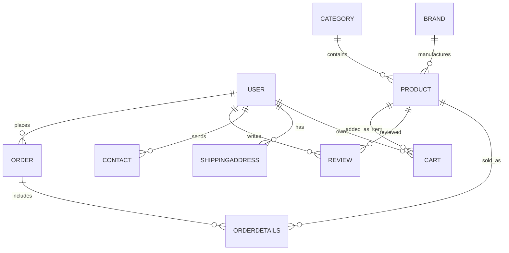
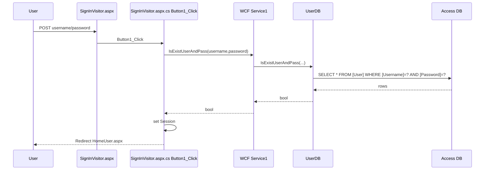
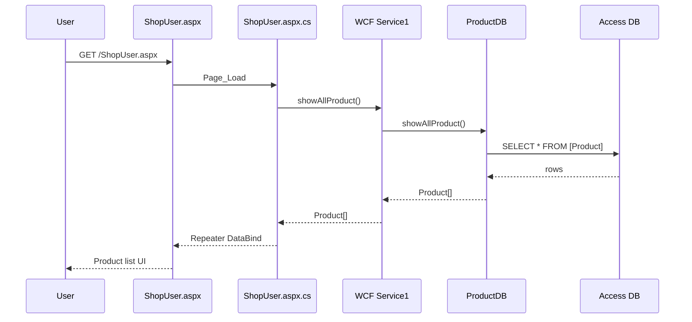
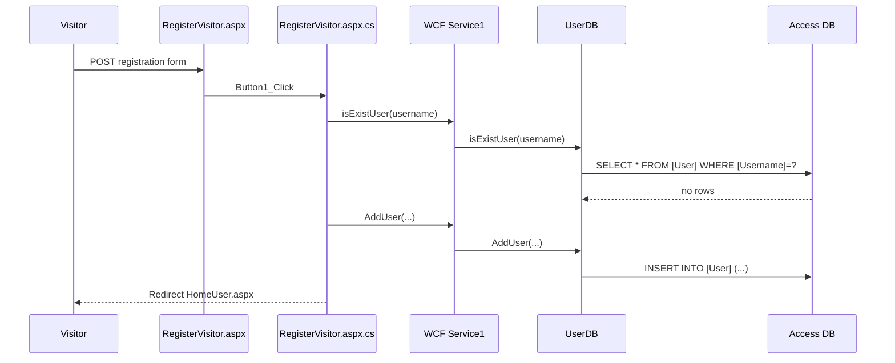
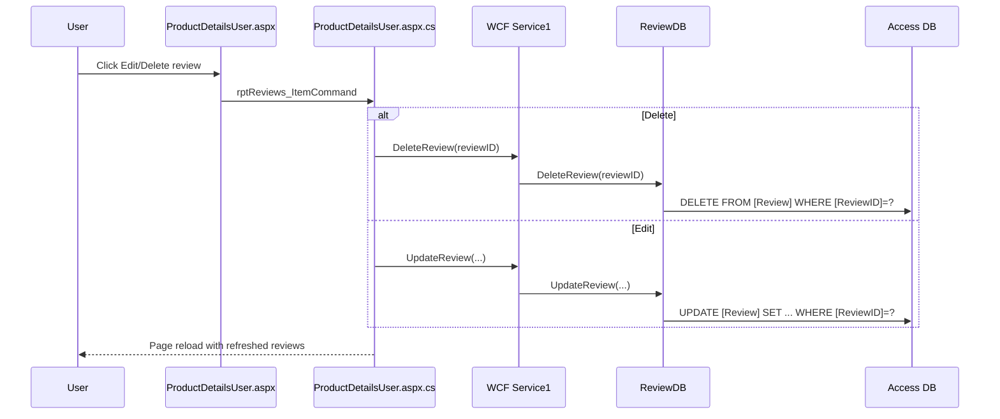

# REFERENCE ARCHITECTURE — HardwareStore Example

## 1) Overview and tech stack

### What this project does
This solution implements a **hardware e-commerce system** with:
- A Web Forms storefront (`Web` website project) for visitors/users (shop, cart, checkout, account, reviews). (Web/HomeVisitor.aspx:83-105, Web/ShopUser.aspx:1-3, Web/CartUser.aspx:1-3, Web/CheckoutUser.aspx:1-3)
- A WCF service (`WcfServiceHardwareStore`) exposing business/data operations. (WcfServiceHardwareStore/Service1.svc:1, WcfServiceHardwareStore/IService1.cs:14-240)
- Data model and data-access class libraries (`ClassLibrary1`, `ClassLibrary2`). (ClassLibrary1/BusinessModelHardwareStore.csproj:74-85, ClassLibrary2/ViewModelHardwareStore.csproj:74-85)
- A separate ASMX payment service (`visa`) for card validation and charging simulation. (visa/visa.asmx:1, visa/App_Code/VisaWebService.cs:27-96)
- A WPF admin/client app (`WpfApp1`) consuming the same WCF service. (WpfApp1/App.config:6-23)

### Language/framework/runtime
- C# / ASP.NET Web Forms / WCF / ASMX / WPF. (HardwareStore.sln:6-45)
- Core projects target **.NET Framework 4.7.2**. (ClassLibrary1/BusinessModelHardwareStore.csproj:12, ClassLibrary2/ViewModelHardwareStore.csproj:12, WcfServiceHardwareStore/WcfServiceHardwareStore.csproj:15, WpfApp1/WpfApp1.csproj:11)
- Website projects (`Web`, `visa`) are configured with target framework moniker 4.8 in solution website properties and web configs. (HardwareStore.sln:19, HardwareStore.sln:46, Web/Web.config:8-17, visa/web.config:19)

### Database system
- Microsoft Access (`.accdb`) via `System.Data.OleDb`. (ClassLibrary2/App_Data/HardwareStore.accdb, ClassLibrary2/DBfunction.cs:8,20)
- Payment service uses another Access DB (`VisaDB.accdb`). (visa/App_Code/VisaWebService.cs:24)

### Main libraries/packages
- ASP.NET MVC/WebPages libraries referenced but web UI is Web Forms style code-behind pages. (Web/packages.config:3-5, Web/ShopUser.aspx:1-3)
- ML.NET used for ForgePC recommendation. (Web/packages.config:8-10, Web/App_Code/PCPredictor.cs:2-3,52-56)
- Rotativa and wkhtmltopdf binaries included and directly invoked in checkout PDF generation. (Web/packages.config:13, Web/CheckoutUser.aspx.cs:390-399)
- Newtonsoft.Json present. (Web/packages.config:12)

### How to run (from code/config)
1. Start `WcfServiceHardwareStore` (`Service1.svc`) so SOAP endpoint is available at configured local URL. (Web/Web.config:28-33, WpfApp1/App.config:16-21)
2. Start `visa` ASMX service (`visa.asmx`) for card calls. (Web/Web.config:5, visa/visa.asmx:1)
3. Run website project `Web` and use Web Forms pages (`HomeVisitor.aspx`, `SignInVisitor.aspx`, etc.). (Web/HomeVisitor.aspx:1, Web/SignInVisitor.aspx:1)

---

## 2) Folder structure (important folders/files)

```text
HardwareStore/
├─ HardwareStore.sln
├─ ClassLibrary1/
│  ├─ BusinessModelHardwareStore.csproj
│  ├─ Brand.cs, Cart.cs, Category.cs, Contact.cs, Order.cs
│  ├─ OrderDetails.cs, Product.cs, Review.cs, ShippingAddress.cs, User.cs
├─ ClassLibrary2/
│  ├─ ViewModelHardwareStore.csproj
│  ├─ DBfunction.cs
│  ├─ BrandDB.cs, CartDB.cs, CategoryDB.cs, ContactDB.cs
│  ├─ OrderDB.cs, OrderDetailsDB.cs, ProductDB.cs, ReviewDB.cs
│  ├─ ShippingAddressDB.cs, UserDB.cs
│  └─ App_Data/HardwareStore.accdb
├─ WcfServiceHardwareStore/
│  ├─ WcfServiceHardwareStore.csproj
│  ├─ Service1.svc
│  ├─ IService1.cs
│  ├─ Service1.svc.cs
│  └─ Web.config
├─ Web/
│  ├─ Web.config
│  ├─ MasterPageVisitor.master(+.cs), MasterPageUser.master(+.cs)
│  ├─ HomeVisitor.aspx(+.cs), SignInVisitor.aspx(+.cs), RegisterVisitor.aspx(+.cs)
│  ├─ AboutUsVisitor.aspx(+.cs), ContactVisitor.aspx(+.cs)
│  ├─ HomeUser.aspx(+.cs), ShopUser.aspx(+.cs), ProductDetailsUser.aspx(+.cs)
│  ├─ CartUser.aspx(+.cs), CheckoutUser.aspx(+.cs), AccountUser.aspx(+.cs)
│  ├─ ContactUser.aspx(+.cs), AboutUsUser.aspx(+.cs), ForgePCUser.aspx(+.cs)
│  ├─ App_Code/PCPredictor.cs
│  ├─ PCData.txt
│  ├─ css/style.css
│  └─ js/main.js
├─ visa/
│  ├─ visa.asmx
│  ├─ App_Code/VisaWebService.cs
│  ├─ App_Data/VisaDB.accdb
│  └─ web.config
└─ WpfApp1/
   ├─ WpfApp1.csproj
   ├─ App.config
   └─ *.xaml + *.xaml.cs windows
```

Evidence: HardwareStore.sln:6-45, project file inventories and listed source files above.

---

## 3) Architecture rules (checklist)

- **Rule 1:** Entity/data-contract classes are plain C# classes in `ClassLibrary1` (`BusinessModelHardwareStore` namespace). (ClassLibrary1/Brand.cs:7-31, ClassLibrary1/User.cs:7-35)
- **Rule 2:** Data-access classes (`*DB.cs`) live in `ClassLibrary2` and execute SQL against Access via `DBfunction`. (ClassLibrary2/BrandDB.cs:9-14, ClassLibrary2/DBfunction.cs:12-70)
- **Rule 3:** SQL is written inline in DB classes as raw SQL strings (parameterized with `OleDbCommand` in most methods). (ClassLibrary2/UserDB.cs:32-45, ClassLibrary2/ProductDB.cs:51-90)
- **Rule 4:** WCF service layer (`Service1.svc.cs`) is a thin pass-through: instantiate `*DB` class, call method, return result. (WcfServiceHardwareStore/Service1.svc.cs:36-65,340-413,490-534)
- **Rule 5:** Web pages call WCF through generated client `ServiceReference1.Service1Client("BasicHttpBinding_IService1")`. (Web/ShopUser.aspx.cs:9, Web/CheckoutUser.aspx.cs:13)
- **Rule 6:** User authentication state is stored in Session keys (`Username`/`username` variants are both used). (Web/SignInVisitor.aspx.cs:26, Web/HomeUser.aspx.cs:12-15, Web/MasterPageUser.master.cs:17-20)
- **Rule 7:** Visitor pages use `MasterPageVisitor`; authenticated pages use `MasterPageUser`. (Web/HomeVisitor.aspx:1, Web/HomeUser.aspx:1)
- **Rule 8:** Each Web Forms page keeps logic in code-behind (`Page_Load`, button handlers, repeater handlers). (Web/CartUser.aspx.cs:13-25,105-132)
- **Rule 9:** Payment logic is externalized to ASMX `visa` service via `Payment.VisaWebService` proxy from web app. (Web/CheckoutUser.aspx.cs:12,149-150,168)
- **Rule 10:** No migration framework/ORM is used; schema is expected to exist in `.accdb` files. (ClassLibrary2/ViewModelHardwareStore.csproj:88-90, ClassLibrary2/DBfunction.cs:20)

---

## 4) Database

### Connection/config locations
| Component | Connection mechanism | Evidence |
|---|---|---|
| Main app DB | Hard-coded Access connection string in `DBfunction` to `HardwareStore.accdb` | ClassLibrary2/DBfunction.cs:20 |
| Main DB file in project | Included as content and copied to output | ClassLibrary2/ViewModelHardwareStore.csproj:88-90 |
| Visa DB | `Server.MapPath("App_Data/VisaDB.accdb")` in ASMX service | visa/App_Code/VisaWebService.cs:24 |
| Legacy visa config key | `connectionStr` appSetting exists but service code constructs its own path | visa/web.config:7-9, visa/App_Code/VisaWebService.cs:24 |

### Tables and columns (from model + SQL usage)

> Nullability/defaults/PK/FK constraints are not explicitly declared in source code => **NOT FOUND IN CODE** unless shown by behavior/query.

| Table | Columns seen in code | CLR type inferred from mapping/parameters | PK | FK | Nullable | Defaults/constraints |
|---|---|---|---|---|---|---|
| Brand | BrandID, BrandName, CountryOfOrigin, WebsiteURL, Description | int/string | NOT FOUND IN CODE | NOT FOUND IN CODE | NOT FOUND IN CODE | NOT FOUND IN CODE |
| Category | CategoryID, CategoryName, Description | int/string | NOT FOUND IN CODE | NOT FOUND IN CODE | NOT FOUND IN CODE | NOT FOUND IN CODE |
| Product | ProductID, ProductName, CategoryID, BrandID, Price, StockQuantity, Description, Picture | int/string/decimal | NOT FOUND IN CODE | Logical CategoryID->Category, BrandID->Brand | NOT FOUND IN CODE | NOT FOUND IN CODE |
| User | Username, Password, PhoneNumber, Email, Admin, JoinDate | string/bool/DateTime | NOT FOUND IN CODE | NOT FOUND IN CODE | NOT FOUND IN CODE | NOT FOUND IN CODE |
| Cart | ProductID, Username, Price, Quantity | int/string/decimal/int | NOT FOUND IN CODE | Logical ProductID->Product, Username->User | NOT FOUND IN CODE | NOT FOUND IN CODE |
| Review | ReviewID, Username, ProductID, Rev, Rating | int/string/int/string/int | NOT FOUND IN CODE | Logical Username->User, ProductID->Product | NOT FOUND IN CODE | NOT FOUND IN CODE |
| Order | OrderID, Username, OrderDate, TotalPrice, Address, AdditionalInstructions, Delivered | int/string/DateTime/decimal/string/bool | NOT FOUND IN CODE | Logical Username->User | NOT FOUND IN CODE | Delivered inserted as false in code |
| OrderDetails | OrderDetailsID, OrderID, ProductID, Quantity, UnitPrice | int/int/int/int/decimal | NOT FOUND IN CODE | Logical OrderID->Order, ProductID->Product | NOT FOUND IN CODE | NOT FOUND IN CODE |
| Contact | ContactID, Username, FullName, Email, Subject, Message, DateSent, Treated | int/string/string/string/string/string/DateTime/bool | NOT FOUND IN CODE | Logical Username->User | NOT FOUND IN CODE | Treated inserted as false |
| ShippingAddress | Username, CountryRegion, City, StreetAddress, Floor, ZipCode, AdditionalInstructions | string/string... | NOT FOUND IN CODE | Logical Username->User | NOT FOUND IN CODE | NOT FOUND IN CODE |
| Visa (payment DB) | CardNumber, HolderName, SecurityCode, Year, Month, Total, Range | string/int/double usage | NOT FOUND IN CODE | NOT FOUND IN CODE | NOT FOUND IN CODE | NOT FOUND IN CODE |

Evidence: model classes in ClassLibrary1/*.cs and SQL/mapping in ClassLibrary2/*DB.cs and visa/App_Code/VisaWebService.cs.

### Relationships (code-inferred)
- `Product.CategoryID` -> `Category.CategoryID` (join/filter). (ClassLibrary2/ProductDB.cs:148-149,174-179)
- `Product.BrandID` -> `Brand.BrandID` (join/filter). (ClassLibrary2/ProductDB.cs:148-149,200-205)
- `Cart.ProductID` -> `Product.ProductID`. (ClassLibrary2/CartDB.cs:178-181)
- `OrderDetails.OrderID` -> `Order.OrderID`; `OrderDetails.ProductID` -> `Product.ProductID`. (ClassLibrary2/OrderDetailsDB.cs:28-33)
- `Review.ProductID` and `Review.Username` logically reference product/user. (ClassLibrary2/ReviewDB.cs:27-33)
- `ShippingAddress.Username`, `Order.Username`, `Contact.Username` logically reference user. (ClassLibrary2/ShippingAddressDB.cs:17-22, ClassLibrary2/OrderDB.cs:30-39, ClassLibrary2/ContactDB.cs:28-37)

### ER diagram (code-inferred)


### Database creation and seeding
- Physical DB files are included in source: `HardwareStore.accdb`, `VisaDB.accdb`. (ClassLibrary2/App_Data/HardwareStore.accdb, visa/App_Data/VisaDB.accdb)
- No SQL schema creation scripts/migrations are present => **NOT FOUND IN CODE**.
- App relies on pre-existing tables/columns and directly executes SQL. (ClassLibrary2/*DB.cs)

---

## 5) Data access

### Pattern
- Raw SQL + `OleDbCommand` + `DataSet` through helper class `DBfunction`. (ClassLibrary2/DBfunction.cs:24-70)
- Parameterized queries are common (`?` placeholders, `AddWithValue`). (ClassLibrary2/BrandDB.cs:19-23,31-43)

### Layer usage
- Web code-behind -> WCF client -> WCF service -> DB classes -> Access SQL. (Web/ShopUser.aspx.cs:9,49-52; WcfServiceHardwareStore/Service1.svc.cs:344-348; ClassLibrary2/ProductDB.cs:95-116)

### Real SQL examples (copyable)

**SELECT** (`showOrder`)  
File: `ClassLibrary2/OrderDB.cs` (96-103)
```csharp
string sql = "SELECT * FROM [Order] WHERE [OrderID] = ?";
OleDbCommand cmd = new OleDbCommand(sql);
cmd.Parameters.AddWithValue("?", OrderID);
DataSet ds = db.SelectcommandInjection(cmd);
```

**INSERT** (`AddUser`)  
File: `ClassLibrary2/UserDB.cs` (32-45)
```csharp
string sql = @"INSERT INTO [User] 
			  ([Username], [Password], [PhoneNumber], [Email], [Admin], [JoinDate]) 
			  VALUES (?, ?, ?, ?, ?, ?)";
OleDbCommand cmd = new OleDbCommand(sql);
cmd.Parameters.AddWithValue("?", Username);
cmd.Parameters.AddWithValue("?", Password);
cmd.Parameters.AddWithValue("?", PhoneNumber);
cmd.Parameters.AddWithValue("?", Email);
cmd.Parameters.AddWithValue("?", Admin);
cmd.Parameters.Add("?", OleDbType.Date).Value = JoinDate;
db.DoCommandInjection(cmd);
```

**UPDATE** (`UpdateCartQuantity`)  
File: `ClassLibrary2/CartDB.cs` (138-144)
```csharp
string sql = "UPDATE Cart SET Quantity = ? WHERE ProductID = ? AND Username = ?";
OleDbCommand cmd = new OleDbCommand(sql);
cmd.Parameters.AddWithValue("?", newQuantity);
cmd.Parameters.AddWithValue("?", ProductID);
cmd.Parameters.AddWithValue("?", Username);
db.DoCommandInjection(cmd);
```

**DELETE** (`DeleteReview`)  
File: `ClassLibrary2/ReviewDB.cs` (39-43)
```csharp
string sql = "DELETE FROM [Review] WHERE [ReviewID] = ?";
OleDbCommand cmd = new OleDbCommand(sql);
cmd.Parameters.AddWithValue("?", ReviewID);
db.DoCommandInjection(cmd);
```

---

## 6) Server side

### Entry points
- Web app pages are Web Forms `.aspx` routes under website root. (Web/*.aspx)
- WCF service endpoint: `/Service1.svc`. (WcfServiceHardwareStore/Service1.svc:1)
- Payment ASMX endpoint: `/visa.asmx`. (visa/visa.asmx:1)

### ALL pages/routes/endpoints

#### Web pages (routes)
| URL | Method(s) | Purpose | Parameters | Auth required | Handler file/function |
|---|---|---|---|---|---|
| /HomeVisitor.aspx | GET | Visitor landing | None | No | Web/HomeVisitor.aspx(.cs) Page_Load |
| /SignInVisitor.aspx | GET, POST | Login | username,password | No | Web/SignInVisitor.aspx.cs:21-42 `Button1_Click` |
| /RegisterVisitor.aspx | GET, POST | Registration | username,password,email,phone | No | Web/RegisterVisitor.aspx.cs:16-61 `Button1_Click` |
| /AboutUsVisitor.aspx | GET | Visitor About | None | No | Web/AboutUsVisitor.aspx(.cs) |
| /ContactVisitor.aspx | GET, POST | Contact form | name,email,subject,message | No | Web/ContactVisitor.aspx.cs:21-57 `btnSend_Click` |
| /HomeUser.aspx | GET | User landing | Session user | Yes | Web/HomeUser.aspx.cs:10-17 |
| /AboutUsUser.aspx | GET | User About | Session user | Yes | Web/AboutUsUser.aspx.cs:10-16 |
| /ShopUser.aspx | GET, POST | Product list/filter/sort/add cart | query `search`, filter controls | Yes | Web/ShopUser.aspx.cs:64-153,155-194 |
| /ProductDetailsUser.aspx?id= | GET, POST | Product details + reviews + add cart | id query, review form | Yes | Web/ProductDetailsUser.aspx.cs:13-32,125-255 |
| /CartUser.aspx | GET, POST | Cart management | Repeater commands | Yes | Web/CartUser.aspx.cs:13-185 |
| /CheckoutUser.aspx | GET, POST | Checkout/payment/order/PDF | address+card fields | Yes | Web/CheckoutUser.aspx.cs:96-223,226-421 |
| /AccountUser.aspx | GET, POST | Profile/password/order history | forms + repeater commands | Yes | Web/AccountUser.aspx.cs:13-310 |
| /ContactUser.aspx | GET, POST | Authenticated contact | form fields | Yes | Web/ContactUser.aspx.cs:9-24,26-65 |
| /ForgePCUser.aspx | GET, POST | ML recommendation quiz | radio selections | Yes | Web/ForgePCUser.aspx.cs:7-14,16-90 |
| /MasterPageUser.master (logout/search) | POST | global search/logout | search term / logout click | Yes | Web/MasterPageUser.master.cs:33-59 |

#### WCF endpoint (SOAP)
| Endpoint | Methods exposed | Auth in service | Handler |
|---|---|---|---|
| /Service1.svc | All `IService1` operation contracts (Brand/Cart/Category/Contact/Order/OrderDetails/Product/Review/ShippingAddress/User + sample methods) | NOT FOUND IN CODE | WcfServiceHardwareStore/IService1.cs:17-239, Service1.svc.cs:15-536 |

#### ASMX payment endpoint
| Endpoint | Method | Purpose | Params | Auth | Handler |
|---|---|---|---|---|---|
| /visa.asmx | `isCardExist` | Validate card identity + expiration | visa, holdername, securitycode, month, year | NOT FOUND IN CODE | visa/App_Code/VisaWebService.cs:72-96 |
| /visa.asmx | `isValidMoney` | Check funds against Range rule | visa, money | NOT FOUND IN CODE | visa/App_Code/VisaWebService.cs:49-69 |
| /visa.asmx | `UpdateTotal` | Deduct balance | visa, money | NOT FOUND IN CODE | visa/App_Code/VisaWebService.cs:28-46 |

### Sessions, login/logout, registration, roles/permissions
- Login sets `Session["username"]`; stores user email. (Web/SignInVisitor.aspx.cs:26-33)
- Logout clears session and abandons session ID cookie. (Web/MasterPageUser.master.cs:47-56)
- Registration creates non-admin user (`Admin=false`) and sets session values. (Web/RegisterVisitor.aspx.cs:42-55)
- Role model exists as `User.Admin` bool and helper `IsUserAdmin` in DB/service. (ClassLibrary1/User.cs:28-34, ClassLibrary2/UserDB.cs:159-174, WcfServiceHardwareStore/IService1.cs:237)
- Web UI role-based authorization checks for admin-specific pages/actions => **NOT FOUND IN CODE**.

### Error handling & validation
- Typical pattern: try/catch in page handlers, show user message/alert. (Web/AccountUser.aspx.cs:45-48,141-144; Web/CheckoutUser.aspx.cs:219-223)
- Field presence checks on forms. (Web/RegisterVisitor.aspx.cs:18-23, Web/ContactUser.aspx.cs:28-35)
- Password complexity validation via regex. (Web/RegisterVisitor.aspx.cs:64-85, Web/AccountUser.aspx.cs:267-289)

---

## 7) Frontend

### How pages are built/served
- ASP.NET Web Forms with `MasterPageVisitor`/`MasterPageUser`, server controls (`asp:TextBox`, `asp:Button`, `asp:Repeater`, validators). (Web/CheckoutUser.aspx:16-23,67-99,120-134)

### Browser ↔ server communication pattern
- Mostly **postback form submits** to code-behind event handlers (`OnClick`, `OnItemCommand`, `OnSelectedIndexChanged`). (Web/CartUser.aspx:28,70,102; Web/ShopUser.aspx:20-21,41-42,74)
- Server-side WCF calls from code-behind (`Service1Client`) then databind to controls. (Web/ShopUser.aspx.cs:9,36-45,49-61)
- No fetch/AJAX API usage found in app code => **NOT FOUND IN CODE**.

### Data display
- Repeaters render product/cart/order/review lists. (Web/ShopUser.aspx:90-126, Web/CartUser.aspx:28-64, Web/AccountUser.aspx:139-175)

### Styling
- Global CSS in `Web/css/style.css`; page-level `<style>` blocks used heavily. (Web/css/style.css:1-869, multiple pages)
- JS behaviors in `Web/js/main.js` and inline scripts per page. (Web/js/main.js:1-179, Web/RegisterVisitor.aspx:57-160)

### RTL/language handling
- Explicit RTL/global language handling => **NOT FOUND IN CODE**.
- Currency is manually displayed with shekel symbol (`₪`). (Web/CartUser.aspx:43-55, Web/CheckoutUser.aspx:130-142)

### Client-side validation
- ASP.NET validators in checkout (`RequiredFieldValidator`). (Web/CheckoutUser.aspx:17-23,29-42,55-56,82-100)
- JS password strength UX in register page. (Web/RegisterVisitor.aspx:72-122)

---

## 8) Conventions

- **Entity naming:** classes singular (`User`, `Product`), properties prefixed `My...`. (ClassLibrary1/Product.cs:14-42)
- **Data access naming:** `<Entity>DB` classes with verbs `Add/Update/Delete/show...`. (ClassLibrary2/ProductDB.cs, ClassLibrary2/UserDB.cs)
- **Service naming:** operation names mirror DB names exactly. (WcfServiceHardwareStore/IService1.cs:27-239)
- **Web code-behind naming:** event handlers `btnX_Click`, `Page_Load`, repeater command handlers. (Web/AccountUser.aspx.cs:81,147,200)
- **Table/column naming:** bracketed SQL identifiers `[User]`, `[Order]`, `[ProductID]`. (ClassLibrary2/UserDB.cs:18,32; ClassLibrary2/OrderDB.cs:30)
- **Comments:** short section comments (`// Product`, `// AddUser`), mostly English, some Hebrew comments. (ClassLibrary2/ContactDB.cs:25,42)

Repeated pattern example:
```csharp
public List<Product> showAllProduct()
{
	string sql = "SELECT * FROM [Product]";
	OleDbCommand cmd = new OleDbCommand(sql);
	DataSet ds = db.SelectcommandInjection(cmd);
	...
}
```
(ClassLibrary2/ProductDB.cs:93-116)

---

## 9) End-to-end flows

## Flow A — Login
1. User submits `/SignInVisitor.aspx` form. (Web/SignInVisitor.aspx:21)
2. `Button1_Click` calls `_ws.IsExistUserAndPass`. (Web/SignInVisitor.aspx.cs:21-24)
3. WCF `Service1.IsExistUserAndPass` forwards to `UserDB.IsExistUserAndPass`. (WcfServiceHardwareStore/Service1.svc.cs:520-524)
4. SQL checks `[User]` table by username/password. (ClassLibrary2/UserDB.cs:146-155)
5. On success, session values set and redirect to `HomeUser.aspx`. (Web/SignInVisitor.aspx.cs:26-36)



## Flow B — View product list
1. User opens `/ShopUser.aspx`. (Web/ShopUser.aspx:1)
2. `Page_Load` -> `BindAllProducts` or `ApplyAllFilters`. (Web/ShopUser.aspx.cs:19-31)
3. Code calls `_ws.showAllProduct()` and optional category/brand methods. (Web/ShopUser.aspx.cs:49-52,101-115)
4. WCF forwards to `ProductDB.showAllProduct / showAllProductByCategoryID / showAllProductByBrandID`. (WcfServiceHardwareStore/Service1.svc.cs:344-368)
5. SQL SELECT runs and results bind to repeater cards. (ClassLibrary2/ProductDB.cs:95-116,176-205; Web/ShopUser.aspx:90-126)



## Flow C — Create record (register user)
1. Visitor submits `/RegisterVisitor.aspx`. (Web/RegisterVisitor.aspx:47)
2. `Button1_Click` validates inputs/password policy. (Web/RegisterVisitor.aspx.cs:18-29,64-85)
3. Calls `_ws.isExistUser`, then `_ws.AddUser(..., Admin=false, JoinDate)`. (Web/RegisterVisitor.aspx.cs:33-49)
4. WCF -> `UserDB.AddUser` -> INSERT into `[User]`. (WcfServiceHardwareStore/Service1.svc.cs:495-499, ClassLibrary2/UserDB.cs:32-46)
5. Session initialized and redirect to `HomeUser.aspx`. (Web/RegisterVisitor.aspx.cs:52-61)



## Flow D — Edit/Delete record (review)
1. User opens product details and existing reviews. (Web/ProductDetailsUser.aspx.cs:27-31,78-86)
2. User clicks Edit/Delete in repeater command. (Web/ProductDetailsUser.aspx:89-94, Web/ProductDetailsUser.aspx.cs:179-215)
3. Edit path: `_ws.UpdateReview(...)`; Delete path: `_ws.DeleteReview(reviewID)`. (Web/ProductDetailsUser.aspx.cs:142,187)
4. WCF forwards to `ReviewDB.UpdateReview/DeleteReview`; SQL UPDATE/DELETE executes. (WcfServiceHardwareStore/Service1.svc.cs:431-435,426-430; ClassLibrary2/ReviewDB.cs:46-56,37-43)
5. UI reloads same page and updated review list appears. (Web/ProductDetailsUser.aspx.cs:188-189,221-222)



---

## 10) Template for adding a new feature (new table + list page + create form)

1. **Create entity class** in `ClassLibrary1/<Entity>.cs` with private fields + `My...` properties (same pattern as `Product.cs`, `User.cs`).
2. **Create DB class** in `ClassLibrary2/<Entity>DB.cs`.
   - Add methods: `isExist`, `Add`, `Update`, `Delete`, `showAll`, `showOne`.
   - Use parameterized `OleDbCommand` and `DBfunction` (`DoCommandInjection`, `SelectcommandInjection`).
3. **Add service contract methods** in `WcfServiceHardwareStore/IService1.cs` under a new section comment for the entity.
4. **Implement service pass-through** methods in `WcfServiceHardwareStore/Service1.svc.cs` (instantiate `<Entity>DB`, call corresponding methods).
5. **Ensure DB schema exists** in `HardwareStore.accdb` with required table/columns (no migrations in code). If schema script is needed, add separately (currently NOT FOUND IN CODE).
6. **Create Web Forms pages**:
   - List page (`<Entity>User.aspx`) with `asp:Repeater`/grid.
   - Create/edit form page or panel with `asp:TextBox`, validators, submit button.
7. **In code-behind**, create `ServiceReference1.Service1Client` and call WCF methods in `Page_Load` + button handlers.
8. **Wire navigation** in `MasterPageUser.master`/`MasterPageVisitor.master` if needed.
9. **Add session/auth checks** in `Page_Load` for protected pages (`if (Session["Username"] == null) redirect`).
10. **Add UX consistency**:
   - Reuse gradient button/card styles.
   - Add try/catch + user feedback labels/alerts.
11. **If feature needs payment or external service**, follow `CheckoutUser.aspx.cs` pattern (validate first, then persist records).
12. **Test flow end-to-end**:
   - UI form -> code-behind handler -> WCF -> DB class SQL -> UI refresh.

---

## Output summary (max 10 lines)
1. The architecture is layered: Web Forms UI -> WCF service -> DB classes -> Access DB.
2. Entity models are in `ClassLibrary1`; SQL logic is in `ClassLibrary2`.
3. WCF `Service1.svc` exposes CRUD/business operations mirroring DB class methods.
4. Web app uses session-based auth and page-level redirect checks.
5. Payment is delegated to separate ASMX service (`visa`) with Access-backed card records.
6. Checkout creates orders + order details, updates card balance, and generates PDF via `wkhtmltopdf`.
7. No migrations/schema scripts were found; DB is file-based and pre-existing.
8. Validation is mostly server-side with additional client-side UX scripts.
9. Role field exists (`User.Admin`) but enforced role-based authorization is NOT FOUND IN CODE.
10. The provided flow templates mirror the exact implemented patterns.

## Files not read or not fully understandable
- Binary DB files: `ClassLibrary2/App_Data/HardwareStore.accdb`, `visa/App_Data/VisaDB.accdb` (binary format).
- Executables/binaries: `Rotativa/wkhtmltopdf.exe`, `wkhtmltoimage.exe` (binary).
- Vendor/minified library source under `Web/lib/**` and `Web/css/bootstrap.min.css` (third-party assets, not project business logic).
- Some generated service metadata files (`*.wsdl`, `*.xsd`, `*.svcinfo`, `.svcmap`) were not used for behavioral claims.